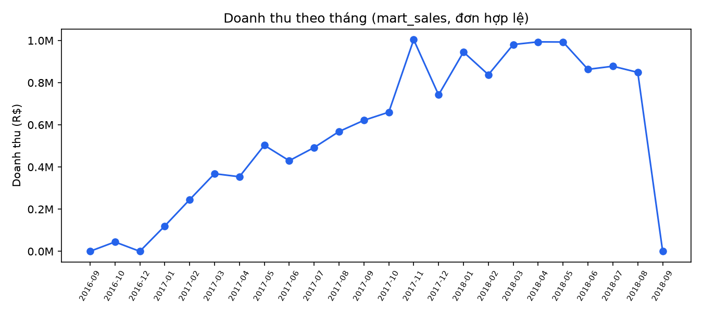
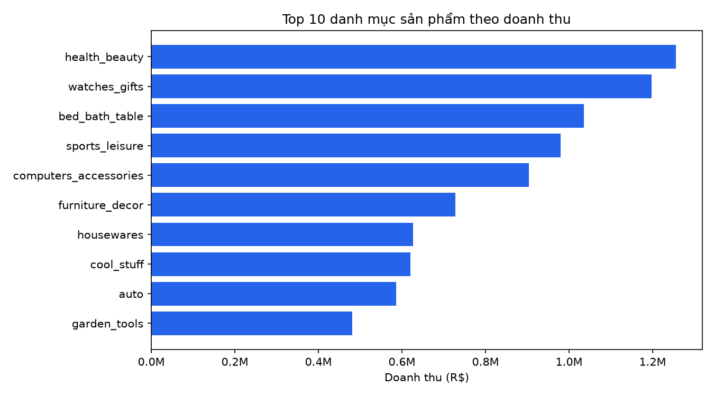
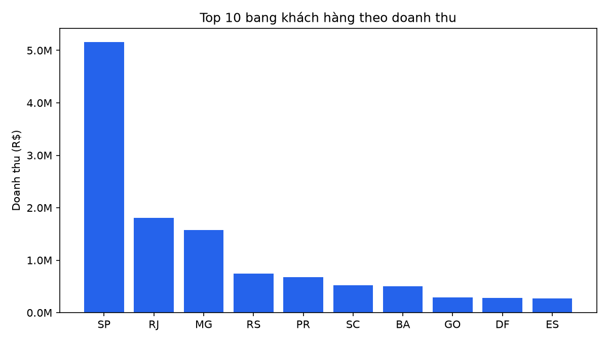
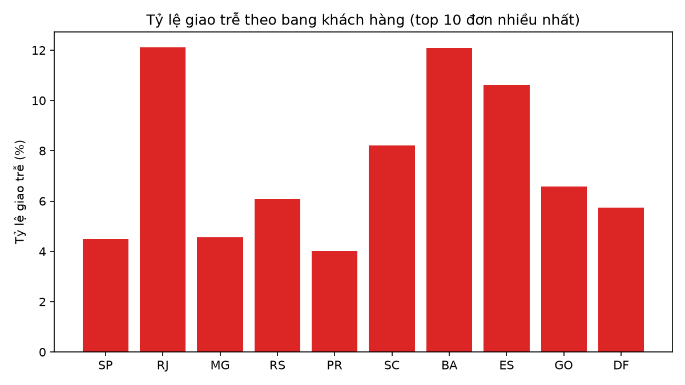
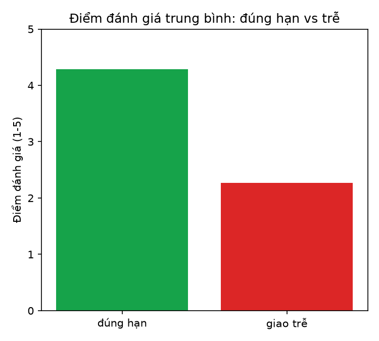
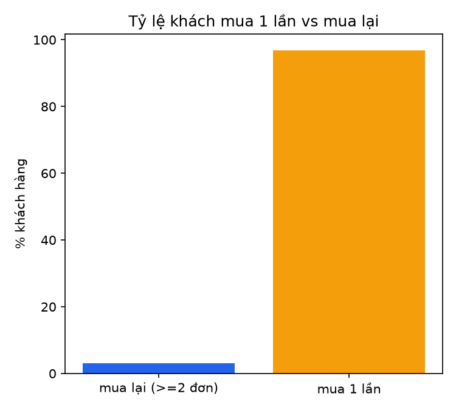
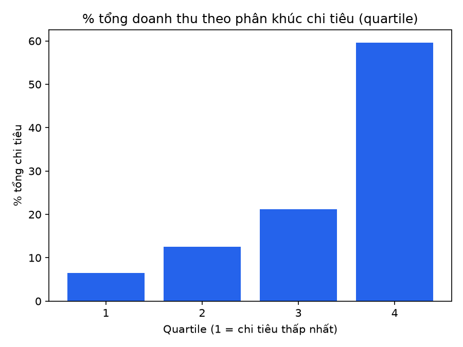

# 3.6 Xây dựng Data Mart & 4.1-4.4 Thử nghiệm, phân tích (Quỳnh Kha)

## 3.6 Data Mart

3 mart trong `dbt_project/models/gold/marts/`, build trên dim/fact do Khôi dựng (D02/D03), chạy bằng `dbt build`:

| Mart | Grain | Nguồn | Mô tả |
|---|---|---|---|
| `mart_sales` | 1 dòng / (order_id, order_item_id) | fact_order_items + fact_orders + dim_product/seller/geography/date | Doanh thu, phí vận chuyển, danh mục, bang khách hàng, người bán, tháng/quý, cờ ngày lễ. Cột `is_valid_sale` loại đơn `canceled`/`unavailable` khỏi KPI doanh thu. |
| `mart_delivery` | 1 dòng / (order_id, seller_id tham gia đơn) | fact_orders + fact_order_items (lấy seller) + fact_reviews | Thời gian giao thực tế, số ngày trễ, cờ giao trễ, điểm đánh giá mới nhất của đơn, bang khách hàng/người bán. Một đơn nhiều seller sẽ lặp dòng - khi gộp cần `count(distinct order_id)`. |
| `mart_customer` | 1 dòng / customer_unique_id | dim_customer + fact_orders + fact_payments | Số đơn, tổng chi tiêu (`sum(payment_value)`), ngày mua đầu/cuối, số ngày từ lần mua gần nhất (so với ngày đặt hàng lớn nhất toàn dữ liệu - không có mốc "hôm nay" hợp lý với dữ liệu lịch sử 2016-2018), cờ khách mua lại. |

Giữ nguyên quy ước của dự án: không dùng `dbt_utils` (project tự viết macro), mart ở grain chi tiết (không tiền tổng hợp) để Chương 4 tự chọn chiều phân tích.

## 3.7 / 4.1 Kiểm thử và đối soát

- `dbt_project/models/gold/marts/schema.yml`: not_null/unique/unique_combination/accepted_values cho 3 mart.
- `dbt_project/tests/test_mart_reconciliation.sql`: đối soát doanh thu, số đơn, tổng chi tiêu giữa mart và fact/dim gốc (sai số < 0,01).
- Kết quả `dbt build` (Bronze → Silver → Gold → Mart), xem [Bang_4.1.1_TomTatKiemThu.csv](tables/Bang_4.1.1_TomTatKiemThu.csv):

| status | số lượng |
|---|---|
| pass | 84 |
| warn | 5 (bất thường dữ liệu nguồn đã biết, không chặn - xem `dbt_project/README.md`) |
| error | 0 |

- Đối soát Gold do Khôi thực hiện: [Bang_3.7.1_DoiSoatGold.csv](tables/Bang_3.7.1_DoiSoatGold.csv) (doanh thu, phí ship, số đơn, giá trị thanh toán khớp tuyệt đối Bronze→Silver→Gold).

## 4.2 Phân tích doanh thu (mart_sales)





**Phát hiện chính:**
1. Doanh thu tăng đều từ 10/2016 đến 11/2017, đạt đỉnh R$1,00M vào 11/2017 (Black Friday) rồi dao động quanh R$0,85-0,99M suốt 2018; dữ liệu kết thúc đột ngột tại 09/2018 (chỉ 1 đơn) - là giới hạn của bộ dữ liệu, không phải sụt giảm thực.
2. Doanh thu tập trung mạnh ở SP (bang có kho vận Olist) - bang đầu bảng cách biệt lớn so với phần còn lại trong top 10, gợi ý rủi ro phụ thuộc một khu vực địa lý.
3. AOV ngày lễ Brazil (R$132,0) thấp hơn nhẹ so với ngày thường (R$137,5) - xem [Bang_4.2.4](tables/Bang_4.2.4_AOV_NgayLe_vs_NgayThuong.csv); không có "hiệu ứng ngày lễ" rõ rệt về giá trị đơn trên dữ liệu này.

## 4.3 Phân tích vận hành giao hàng (mart_delivery)




**Phát hiện chính:**
1. RJ (12,1%) và BA (12,1%) có tỷ lệ giao trễ cao gấp ~2,7 lần SP (4,5%) - vận hành giao hàng không đồng đều giữa các bang, có thể do khoảng cách tới trung tâm phân phối.
2. Điểm đánh giá trung bình giảm mạnh khi giao trễ: 4,29 (đúng hạn) so với 2,27 (trễ) - giao trễ là yếu tố tác động tiêu cực lớn nhất đến trải nghiệm khách hàng trong dữ liệu.
3. Top người bán có tỷ lệ giao trễ cao nhất ([Bang_4.3.2](tables/Bang_4.3.2_TopSellerGiaoTre.csv), lọc >= 30 đơn) là nhóm cần ưu tiên rà soát vận hành/đối tác vận chuyển.

## 4.4 Phân tích khách hàng (mart_customer)




**Phát hiện chính:**
1. Chỉ 3,12% khách hàng (customer_unique_id) mua lại (>=2 đơn), nhưng nhóm này chi tiêu trung bình R$315 - gần gấp đôi nhóm mua 1 lần (R$162). Tỷ lệ mua lại thấp là đặc điểm đã biết của bộ dữ liệu Olist.
2. Doanh thu tập trung cao: 25% khách chi tiêu nhiều nhất (quartile 4) đóng góp 59,65% tổng doanh thu - gợi ý ưu tiên giữ chân nhóm khách giá trị cao.
3. Phân bố recency ([Bang_4.4.3](tables/Bang_4.4.3_PhanBoRecency.csv)) cho thấy phần lớn khách có lần mua gần nhất đã hơn 1 năm (so với mốc cuối dữ liệu) - hệ quả trực tiếp của tỷ lệ mua lại thấp, không phải khách đang "rời bỏ" theo nghĩa vận hành thời gian thực.

## Cách tái tạo kết quả

```bash
# venv/dbt/duckdb cục bộ, không commit (xem .gitignore)
python -m venv .venv312 && .venv312/Scripts/pip install -r requirements.txt
.venv312/Scripts/python scripts/load_bronze.py          # nạp 10 bảng bronze_* (tạm thời - B01 chính thức sẽ thay thế)
cd dbt_project && ../.venv312/Scripts/dbt build          # Silver -> Gold (dim/fact) -> Mart, chạy toàn bộ test
cd .. && .venv312/Scripts/python scripts/run_e04_analytics.py   # E04: bảng + hình Chương 4
.venv312/Scripts/python scripts/export_parquet.py               # E05: data/exports/*.parquet
```
